# KronPlan — Agile Planning & Estimation

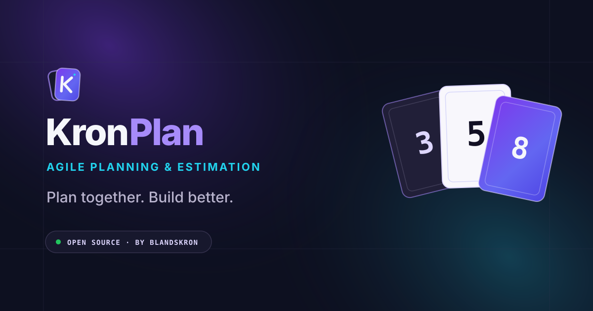

[](https://github.com/Blandskron/KronPlan/actions/workflows/ci.yml)
[](https://github.com/Blandskron/KronPlan/releases/latest)
[](https://blandskron.github.io/KronPlan/)
[](LICENSE)
[](https://www.python.org/downloads/)

**KronPlan** (*Plan together. Build better.*) is an open source, fast, and privacy-first agile planning and estimation platform by **BLANDSKRON**. Built natively with Django, WebSockets, HTML, CSS, and Vanilla JavaScript—no SPA frameworks, zero build bloat.

> **Interactive Visual Showcase (GitHub Pages):** [blandskron.github.io/KronPlan](https://blandskron.github.io/KronPlan/) — explore the full 10-step live flow and all views in Dark, Light, Desktop, and Mobile modes.

## Features
- **Facilitator & Guest Architecture:** Only the creator needs an account. Guests join simply by entering a name via a shared URL (`/p/<public_id>/`).
- **Real-time WebSockets:** Powered by Django Channels and Redis. Live updates for participants joining, voting status, issue switching, deck expansion, and synchronized reveal.
- **Vote Privacy Guarantee:** Server-Side Authority ensures vote payloads are never transmitted to clients until the facilitator explicitly triggers a reveal.
- **Issue Tracking:** Built-in queue for issues to be estimated, allowing the facilitator to focus discussion, save the final estimate, and move to the next story.
- **A Table, Not a Form:** Seats are arranged on an arc-length-computed elliptical ring, the felt reports the round live, the deck is a fanned hand with optional keyboard shortcuts (`0–9`, `?`, arrow keys), and the reveal triggers a countdown, staggered 3D card flip, and consensus highlight.
- **Characters:** Each person chooses a pet and color (or receives a deterministic hash-derived identity) that reflects round state without creating pressure.
- **Optional Playful Layer:** Soft cosmetic throws and recess mode—rate-limited by the server, non-accumulating, and independently toggleable per room and per screen (see `docs/DECISIONS.md` ADR-005).
- **BLANDSKRON / KronPlan Design System:** Dark mode by default with Light and System themes, `Sora` + `Inter` + `JetBrains Mono`, WCAG 2.2 AA calibrated contrast, Lucide SVG icons, and GPU-only animations respecting `prefers-reduced-motion`.

## Video Walkthrough (Narrated in Spanish)

Watch the full end-to-end narrated walkthrough (2m 25s, 720p H.264 + Spanish voiceover and WebVTT captions) directly on GitHub Pages or download the video from the repository:

[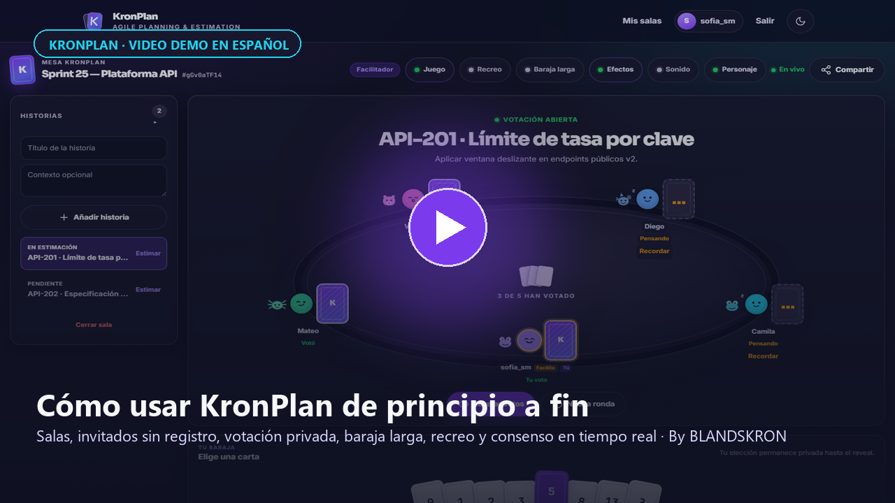](https://blandskron.github.io/KronPlan/#video)

- **Watch online with chapters:** [blandskron.github.io/KronPlan/#video](https://blandskron.github.io/KronPlan/#video)
- **Video file (`7.1 MB`):** [`docs/media/kronplan-walkthrough.mp4`](docs/media/kronplan-walkthrough.mp4)
- **Spanish captions (WebVTT):** [`docs/media/kronplan-walkthrough.es.vtt`](docs/media/kronplan-walkthrough.es.vtt)

<details>
<summary>Video chapters (10 sections · 02:25)</summary>

| Time | Chapter |
| --- | --- |
| `00:00` | 01 · Presentación de KronPlan |
| `00:19` | 02 · Registro y Dashboard Bento |
| `00:35` | 03 · Nueva sala y cola de historias |
| `00:50` | 04 · Ingreso de invitados sin cuenta |
| `01:01` | 05 · Mesa en vivo y privacidad del voto |
| `01:18` | 06 · Baraja larga y personaje |
| `01:31` | 07 · Modo recreo y capa lúdica |
| `01:43` | 08 · Revelación sincronizada y consenso |
| `01:58` | 09 · Ronda dividida y análisis |
| `02:10` | 10 · Modo claro, oscuro y cierre |

</details>

## Screenshots & Product Flow

### Dark & Light Modes (Desktop)

| Live Voting (Dark Mode — Default) | Live Voting (Light Mode — High Contrast) |
| --- | --- |
| 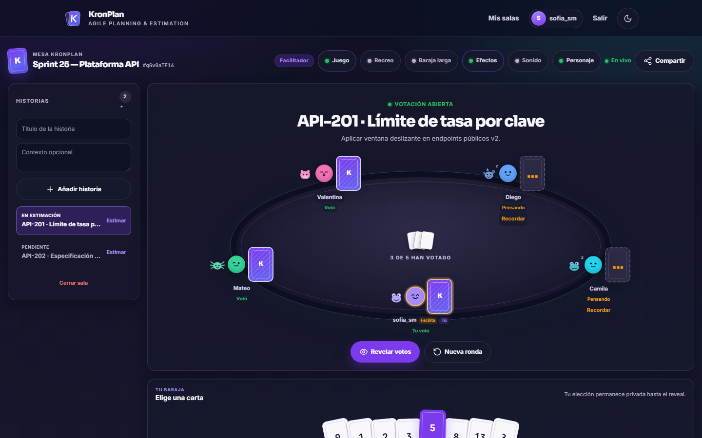 | 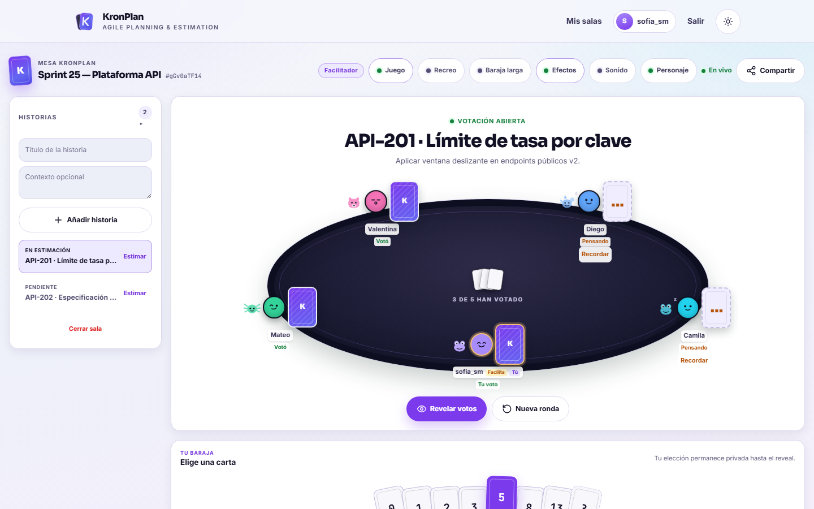 |

| Revealed Round & Distribution (Dark) | Revealed Round & Distribution (Light) |
| --- | --- |
| 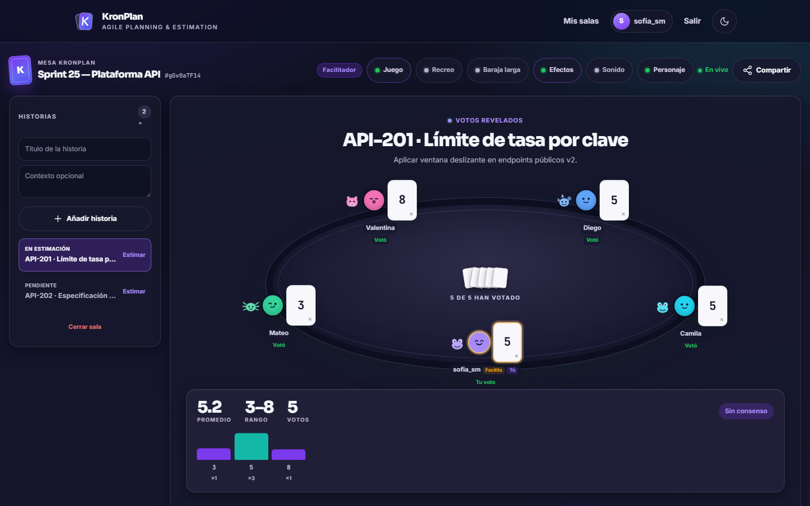 | 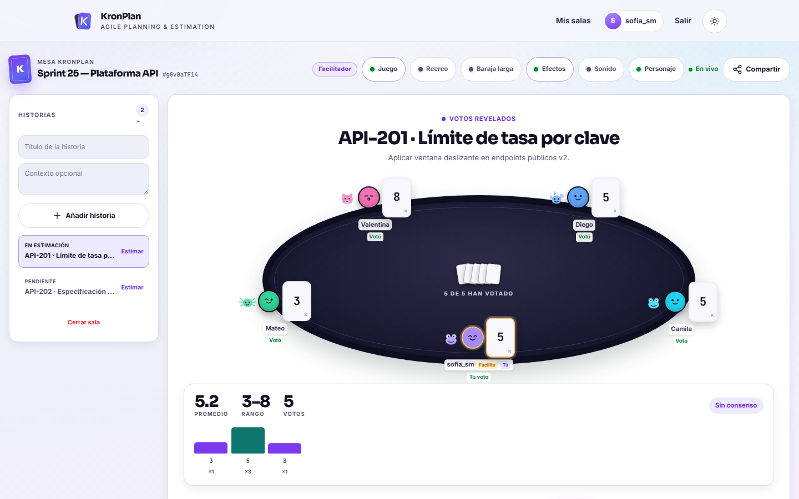 |

### End-to-End Product Flow

| 1. Public Landing | 2. Passwordless Guest Join & Pet Identity |
| --- | --- |
| 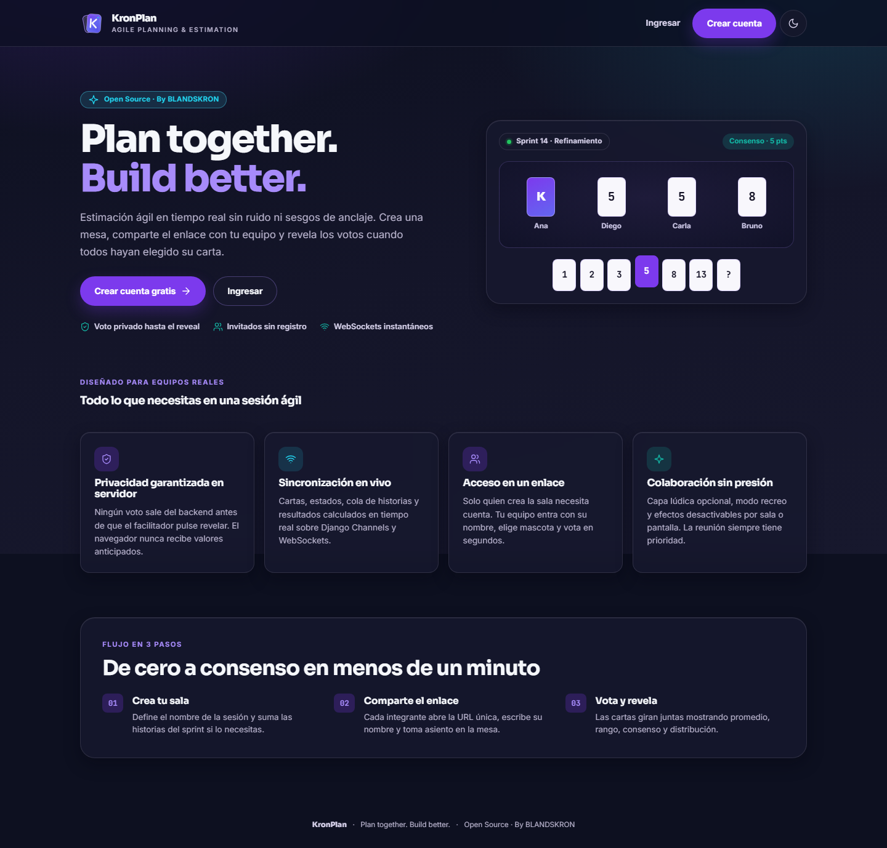 | 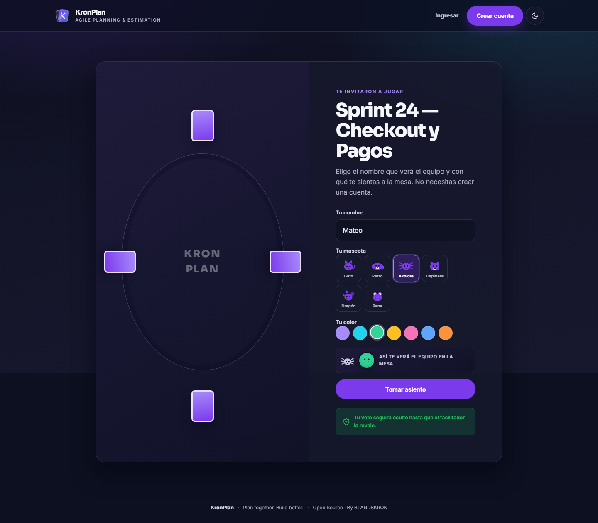 |

| 3. Extended Deck & Character Picker | 4. Interactive Recess Mode |
| --- | --- |
| 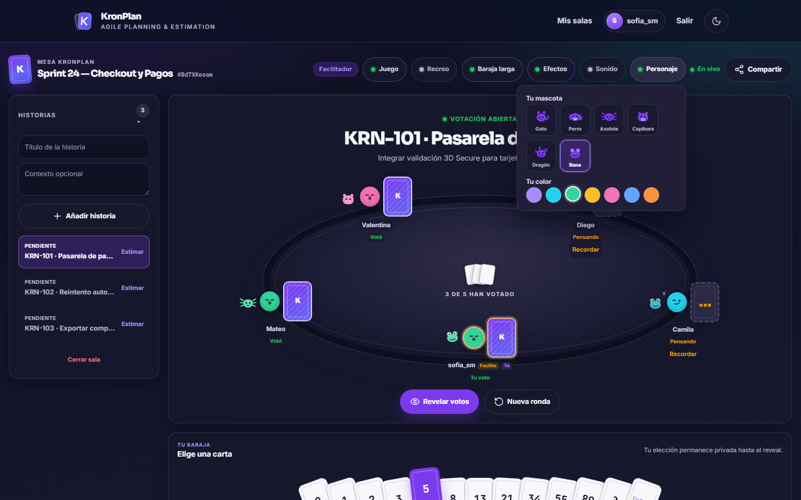 | 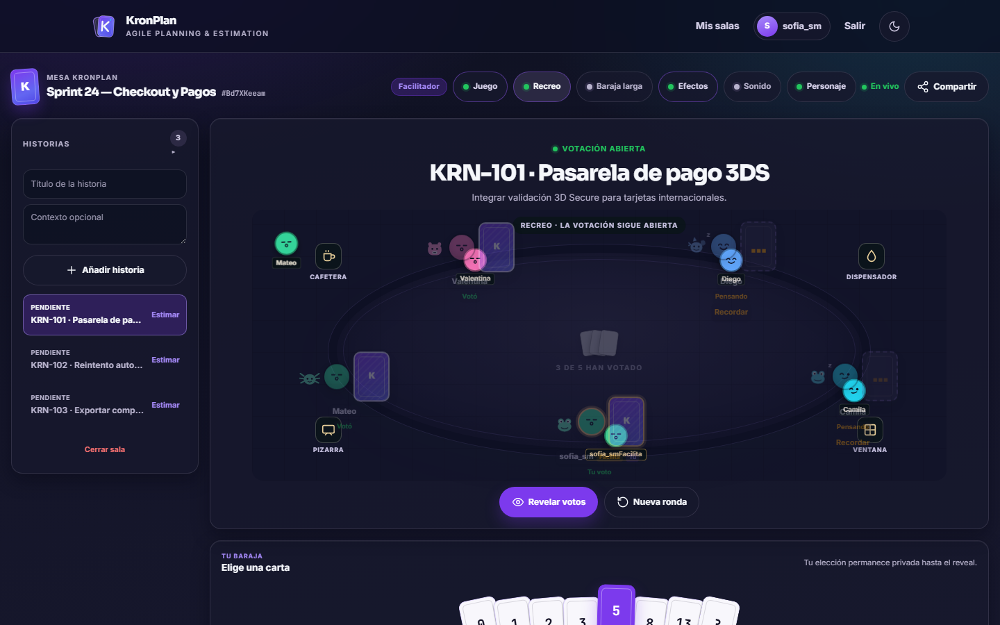 |

| 5. Synchronized Reveal & Consensus | 6. Facilitator Bento Dashboard |
| --- | --- |
| 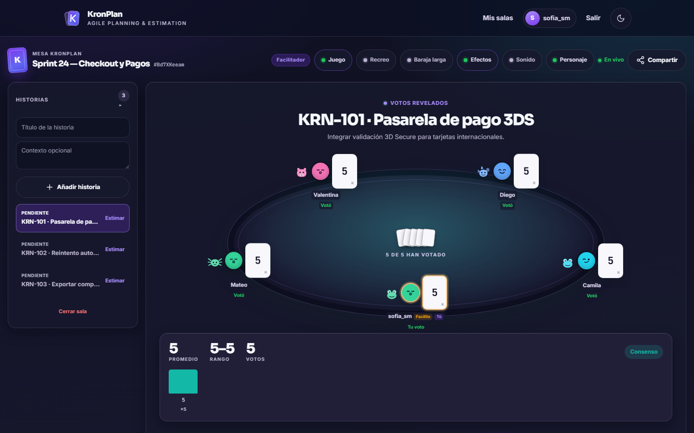 | 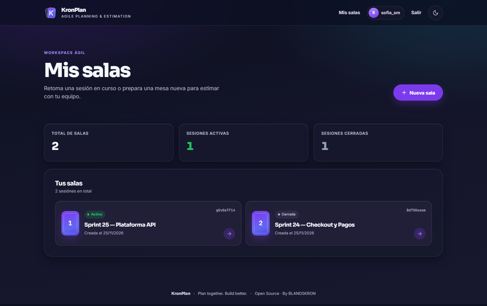 |

### Mobile Experience (`390×844` — Dark & Light)

| Landing (Dark) | Dashboard (Light) | Voting Sheet (Dark) | Revealed (Light) |
| --- | --- | --- | --- |
| 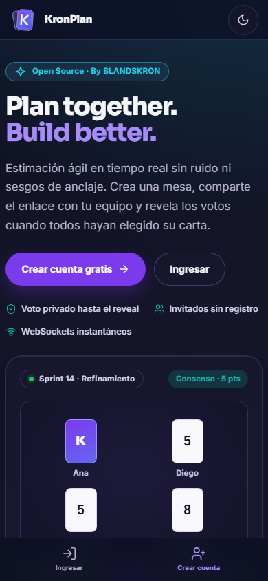 | 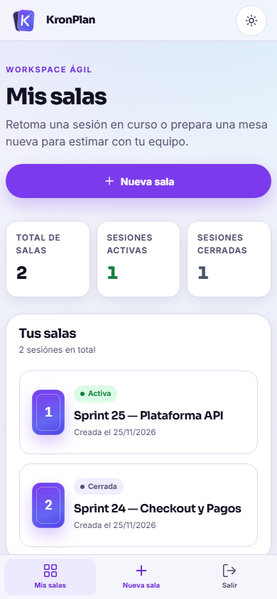 | 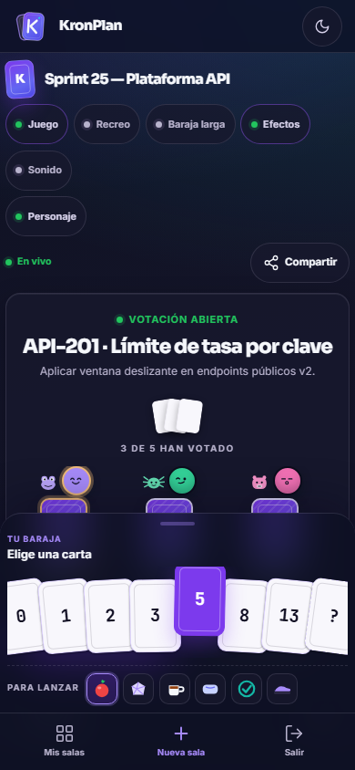 | 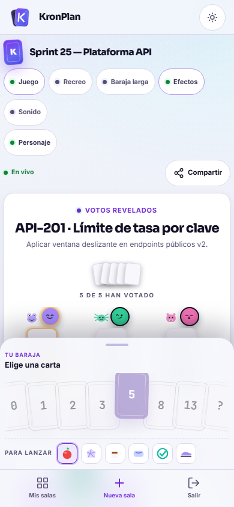 |

## Brand & Design Documentation
- Brand Identity: [docs/BRAND_GUIDELINES.md](docs/BRAND_GUIDELINES.md)
- Design System & Tokens: [docs/DESIGN_SYSTEM.md](docs/DESIGN_SYSTEM.md)
- Architecture & ADRs: [docs/ARCHITECTURE.md](docs/ARCHITECTURE.md), [docs/DECISIONS.md](docs/DECISIONS.md)

## Tech Stack
- **Backend:** Python 3.12+ (3.15-slim in Docker), Django 6.1
- **Real-time:** Django Channels, Daphne, Redis (Production), Vanilla JS (Frontend)
- **Database:** PostgreSQL (Production) / SQLite (Local)
- **Testing:** Pytest, pytest-django, Playwright
- **CI:** GitHub Actions — Ruff lint, Pytest with ≥ 80% coverage floor, Playwright E2E, `check --deploy`, and Docker boot verification

## Getting Started (Local Development)

### 1. Setup Environment
```powershell
python --version # Python 3.12+ is required (Django 6.1 needs it)
python -m venv .venv
.\.venv\Scripts\Activate.ps1
python -m pip install -r requirements-dev.txt
```

### 2. Database Setup
```powershell
python manage.py migrate
```

### 3. Run Server
```powershell
python manage.py runserver
```
Navigate to `http://localhost:8000`.

### 4. Running Tests
```powershell
python -m pytest . -p no:cacheprovider
python -m ruff check .
python manage.py check
```

With coverage (CI floor: 80%):
```powershell
python -m pytest . --cov --cov-report=term-missing
```

Browser tests live behind the `e2e` marker (`docs/TESTING.md`):
```powershell
python -m playwright install chromium   # once
$env:DJANGO_ALLOW_ASYNC_UNSAFE = "true"; python -m pytest -m e2e
```

## Production Deployment

Includes `Dockerfile` and `docker-compose.yml` configured for PostgreSQL and Redis:

```bash
docker-compose up --build -d
```

For production, set `DJANGO_SECRET_KEY`, `DJANGO_ALLOWED_HOSTS`, `DJANGO_CSRF_TRUSTED_ORIGINS`, and `DATABASE_URL` when using an external database. Start from `.env.example`; never commit `.env`.

## Contributing & Security

`main` is always deployable; changes arrive through CI-verified pull requests ([CONTRIBUTING.md](CONTRIBUTING.md), [AGENTS.md](AGENTS.md)).
Release history: [CHANGELOG.md](CHANGELOG.md).
Found a security bug? Do not open a public issue — see [SECURITY.md](SECURITY.md).

## License

MIT. See [LICENSE](LICENSE).

---
*Open Source · By BLANDSKRON — Plan together. Build better.*
